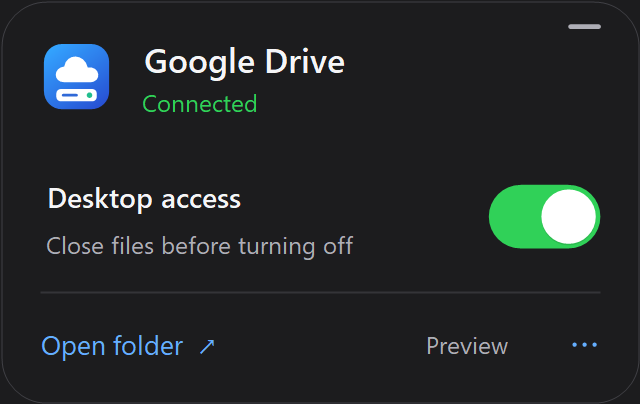

# Google Drive Widget

A Windows tray widget for mounting Google Drive on demand with [rclone](https://rclone.org/). Use the **Desktop access** switch to open Drive in Explorer when you need it. When you switch it off, the widget checks for pending uploads and recent file activity before asking rclone to unmount.



- Open the widget from the tray or a desktop shortcut. Opening it only displays the mount status.
- Drag the card by its header, hide it to the tray, or use **Keep on top**.
- The card follows the Windows app theme and updates when the theme changes.

## Build and preview

On x64 Windows, open Windows PowerShell 5.1 in the checkout. The build uses the x64 .NET Framework C# compiler installed with Windows.

```powershell
.\Build-Widget.ps1
Start-Process .\bin\GoogleDriveWidget.exe -ArgumentList '--preview on --theme dark'
```

Preview mode works without rclone, a Google account, or a scheduled task. Use `on`, `off`, `busy`, or `error` for the preview state and `light` or `dark` to override the Windows theme.

## Set up an existing rclone mount

Install [rclone and WinFsp](https://rclone.org/commands/rclone_mount/#installing-on-windows) and configure a [Google Drive remote](https://rclone.org/drive/). The widget controls an existing enabled task in the root **Task Scheduler Library**. Use these settings for that task:

- Run it under the same Windows account that will use the widget. Choose **Run whether user is logged on or not** and allow Task Scheduler to store the account password. This uses the `Password` logon type.
- Use the full path to `rclone.exe` as its sole action. Start the arguments with `mount`, the remote name followed by a colon, and an absolute local mount directory. The mount directory should be absent when disconnected. Its parent directory should exist.
- Enable VFS caching and write an INFO-level text log. For example, with the parent directories already created:

  ```text
  mount gdrive: "C:\Mounts\Google Drive" --vfs-cache-mode full --log-level INFO --log-file "C:\Mounts\google-drive.log"
  ```

- Keep port `5579` available. The installer adds the [rclone control API](https://rclone.org/rc/) with a generated password and binds it to `127.0.0.1`. Start with a task that has no other remote-control settings.

Verify the original task can mount Drive and make it visible to your Windows session. Save and close Drive files, let uploads finish, and stop rclone normally before installing. Use a runtime folder on the local disk outside the Drive mount. For example:

```powershell
$widgetDir = Join-Path $env:LOCALAPPDATA 'GoogleDriveWidget'
.\Build-Widget.ps1 -OutputDirectory $widgetDir
Copy-Item Prepare-Widget.ps1, Install-Widget.ps1, Enable-WidgetStartup.ps1 -Destination $widgetDir
Set-Location -LiteralPath $widgetDir
.\Prepare-Widget.ps1 -TaskName 'Rclone Google Drive' -Remote 'gdrive:' `
    -MountPath 'C:\Mounts\Google Drive' -LogPath 'C:\Mounts\google-drive.log' `
    -RclonePath 'C:\Program Files\rclone\rclone.exe'
```

Run `Prepare-Widget.ps1` as the mount task account. Use the exact task name and paths from your task. Then open an **administrator** Windows PowerShell window in the same runtime folder and run `.\Install-Widget.ps1`. Enter the task account's Windows password when prompted. Task Scheduler requires that password to update the task. The installer saves the original task definition and permissions, disables its automatic triggers and retries, and leaves it stopped.

Back in the mount task account's regular PowerShell window, run `.\Enable-WidgetStartup.ps1` to add desktop and sign-in shortcuts, or open `.\GoogleDriveWidget.exe` directly. Verify the switch can mount Drive and disconnect after files are closed and uploads have finished.

## Daily use and restore

Save and close all Drive files before switching off. Leave them closed while the widget checks the upload queue and waits for two separate idle reports. Some open Windows file handles can escape detection. If there is a cache error or the widget cannot verify activity, Drive stays mounted. Use **Cancel** while waiting to resume work. Use **Status details** to diagnose an error.

To restore the original task settings, close the widget, make sure the mount is stopped, then run `.\Install-Widget.ps1 -Restore` from an administrator PowerShell window in the runtime folder. Keep `original-task.xml` and `original-task-security.txt` there until you have restored the task. Remove the **Google Drive Widget** shortcut from the Windows Startup folder if you also want to disable widget startup.

## Run the checks

```powershell
.\Test-Widget.ps1
```

The checks cover mount state and disconnect behavior with fake dependencies, loopback HTTP error handling, and installer argument and credential validation. They use temporary or ignored build files and synthetic credentials.
